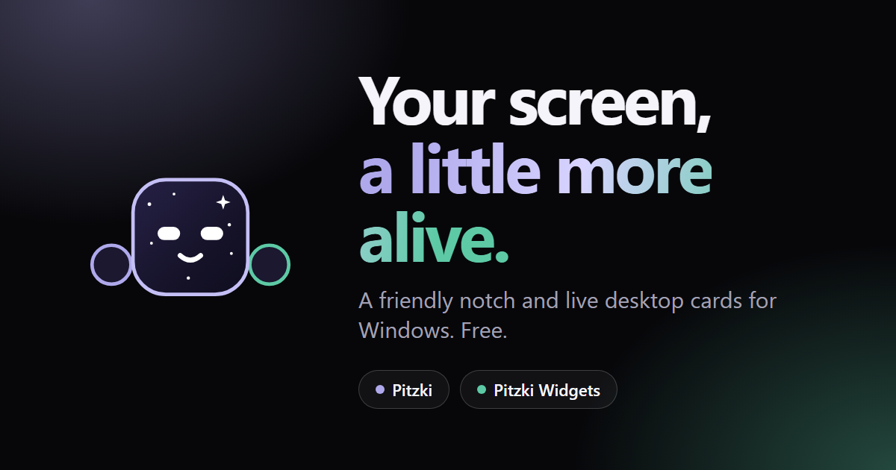
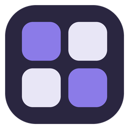
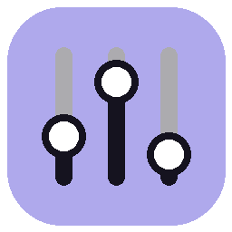

# Pitzki

**A family of small, friendly apps for your Windows screen.**
Free, no account, no ads.

[**Visit the website →**](https://yahavpenso.github.io/)

---

## Download now

| | App | What it does | |
|---|---|---|---|
|  | **Pitzki** | A friendly little notch at the top of your screen: music with live lyrics, timers, tasks, calendar and game tabs. | [Website](https://yahavpenso.github.io/Piztki/) · [Download](https://github.com/yahavpenso/Piztki/releases) |
|  | **Pitzki Widgets** | 43 little live cards on your desktop: clock, weather, tasks, stocks, music, Steam and more, with Pitzki living in them. | [Website](https://yahavpenso.github.io/PitzkiWidgets/) · [Download](https://github.com/yahavpenso/PitzkiWidgets/releases/latest) |

## Ready, download on the way

| | App | What it does |
|---|---|---|
|  | **Pitzki Volume** | A volume slider for every app, opens with Ctrl+Alt+V. |
| 🎞️ | **Pitzki GIF** | Record any part of your screen as a GIF or an MP4. |
| 🧹 | **Pitzki Clean** | See what fills your disk and clear the junk in one click. |
| 📲 | **Pitzki Send** | Send a file from your PC to your phone by scanning a code, over your own Wi-Fi. |

## Coming soon (28 more)

| | App | What it will do |
|---|---|---|
| 🎁 | **Pitzki Free Games** | Free games on Epic, Steam and GOG, with a ping when a new one drops |
| 🏷️ | **Pitzki Sales** | Watches your Steam wishlist and tells you when a game goes on sale |
| 🧱 | **Pitzki Roblox Codes** | Working codes for popular Roblox games, in one place |
| 🛒 | **Pitzki Fortnite Shop** | Today's Fortnite item shop, right on your screen |
| 🏆 | **Pitzki Achievements** | All your Steam achievements, and which ones are closest |
| 🖼️ | **Pitzki Thumbnail** | YouTube thumbnails from ready-made templates |
| 📦 | **Pitzki Compress** | Shrinks a video under 10 MB so it fits on Discord |
| ✂️ | **Pitzki Cutter** | Trim a video in seconds, without re-encoding |
| 🔁 | **Pitzki Converter** | Drag in a picture, video or sound, get it in another format |
| 🎵 | **Pitzki Music** | A small player with the song that's playing and its lyrics |
| 🎙️ | **Pitzki Mic Check** | Record yourself and hear how you sound |
| 🔇 | **Pitzki Noise** | Removes background noise from your mic |
| ⏳ | **Pitzki Countdown** | Count down to the holidays, a test or a big day |
| 📝 | **Pitzki Summary** | Turns a long text into short points |
| 🚀 | **Pitzki Launcher** | Find and open anything in a flash |
| 👯 | **Pitzki Duplicate** | Finds duplicate files so you can clear them |
| 🗺️ | **Pitzki Disk Map** | A picture of what takes up your disk |
| 🔋 | **Pitzki Battery** | Battery level of your laptop, headphones and mouse |
| 📶 | **Pitzki Wi-Fi** | See who's on your home network |
| 🌙 | **Pitzki Night** | A blue-light filter that gets warmer at night |
| 🎨 | **Pitzki Color Picker** | Pick a color from anywhere on the screen |
| 💾 | **Pitzki Backup** | Backs up your important folders by itself |
| 📱 | **Pitzki Remote** | Control your PC from your phone: music, volume, power |
| 🔔 | **Pitzki Notify** | Your phone notifications, on your PC |
| 📡 | **Pitzki Status** | Check from your phone if your PC is on and how it is doing |
| 🃏 | **Pitzki Collect** | Rare Pitzki cards that unlock as you use your PC |
| 🏬 | **Pitzki Store** | Every Pitzki app in one place, installed and updated for you |
| 🪪 | **Pitzki Profile** | One gamer profile with your stats from every game |

## About this repository

This is the source of the Pitzki home page at **[yahavpenso.github.io](https://yahavpenso.github.io/)**. It's a single page (`index.html`) with the clips and pictures it shows in `media/` and `scenes/`. Every clip is a 60 fps MP4, with the original GIF kept next to it as a fallback.

Found a bug or have an idea? Open an issue on [Pitzki](https://github.com/yahavpenso/Piztki/issues) or [Pitzki Widgets](https://github.com/yahavpenso/PitzkiWidgets/issues).

Windows 10 and 11 · Free for everyone · Not affiliated with Microsoft or any game named here

